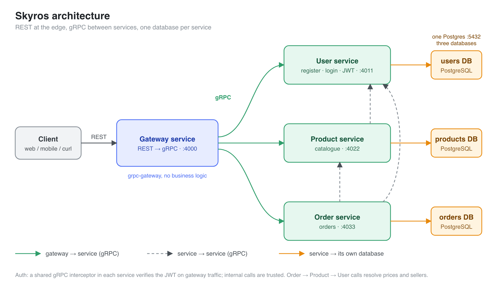
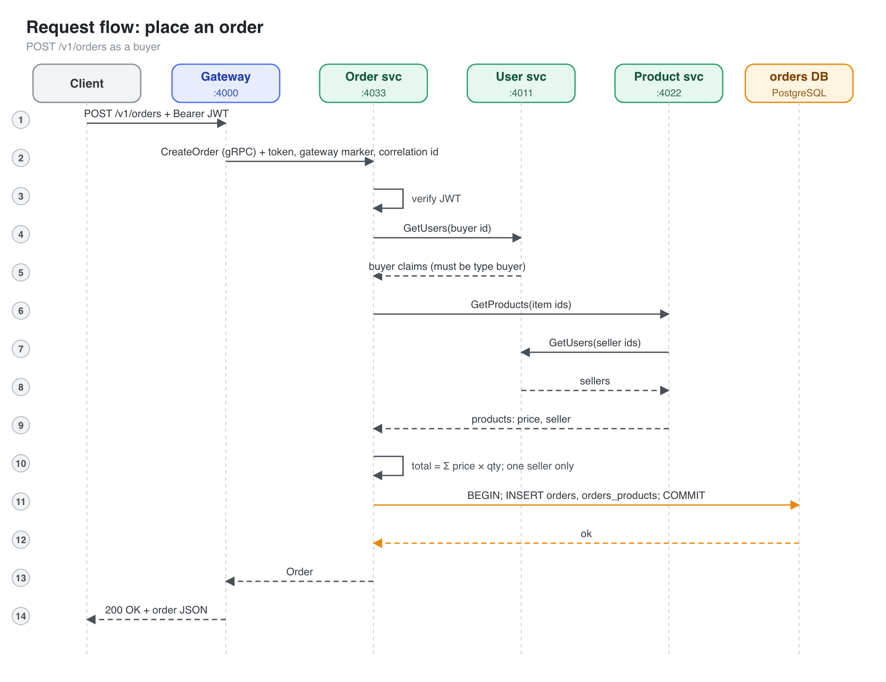

# skyros

[](https://github.com/situmorangbastian/skyros/actions/workflows/ci.yml)


Skyros is a small e-commerce backend built as **Go microservices**. Services talk to each other over **gRPC**, and an **API gateway** exposes one REST interface to clients. Each service owns its own PostgreSQL database.

It is a portfolio project. It shows how I structure services, handle authentication across service boundaries, and keep the code testable. It is not a production system, and the [limitations](#known-limitations) section says where it stops.

## What it does

- Buyers and sellers register and log in and receive a JWT.
- Sellers create products and see only their own products.
- Buyers browse the catalogue and place orders. An order's total is calculated on the server from the current product prices.
- Buyers see only their own orders and sellers see only orders placed with them.

## Architecture



| Service | Responsibility | Owns |
| --- | --- | --- |
| `gatewayservice` | Public REST entry point. It translates REST to gRPC with [grpc-gateway](https://github.com/grpc-ecosystem/grpc-gateway) and has no business logic. | nothing |
| `userservice` | Registration, login, JWT issuing, user lookup for other services | `userservice` DB |
| `productservice` | Product catalogue, with seller details resolved from `userservice` | `productservice` DB |
| `orderservice` | Order placement and history. It validates products and prices through `productservice`. | `orderservice` DB |

### Request flow: placing an order



### Design decisions

- **Contract-first.** The `.proto` files in [`proto/`](proto) define the gRPC API and the REST routes together (through `google.api.http` annotations), so the two cannot drift.
- **Layered services.** Each service follows `service` (transport and validation) → `usecase` (business rules) → `repository` (SQL). Usecases depend on interfaces, so they are unit-tested with fakes and no database.
- **Authentication happens in the services.** The gateway forwards the `Authorization` header and tags the call with `x-skyros-gateway`. A shared gRPC interceptor ([`serviceutils/auth`](serviceutils/auth)) verifies the JWT and loads the user from `userservice`. It fails closed on the gateway path, so a missing, invalid or unknown-user token is rejected. Calls without the marker are treated as trusted internal gRPC traffic.
- **Authorization lives in the usecase.** Each query is scoped to the caller. Buyers see their own orders, sellers see orders addressed to them, and a seller's product list is filtered to their own products.
- **Database per service.** There are no cross-service joins. Data from other services is fetched over gRPC and merged in the usecase.
- **Observability.** Every request gets an `x-correlation-id`. It is propagated across gRPC hops and written to the structured zerolog output. It is also returned in the error details.
- **Migrations run at startup** with golang-migrate (SQL files in each service's `migrations/` folder).
- **Small images.** Multi-stage Docker builds produce static binaries on distroless, non-root images.

## Tech stack

| Layer | Technology |
| --- | --- |
| Language | Go 1.27 |
| API gateway | grpc-gateway v2 |
| Service-to-service | gRPC, Protocol Buffers (managed with [buf](https://buf.build)) |
| Database | PostgreSQL 16, pgx, squirrel |
| Auth | JWT (HS256), bcrypt |
| Logging | zerolog |
| Containers | Docker, Docker Compose |
| CI | GitHub Actions: vet, test with `-race`, golangci-lint, govulncheck |

## Getting started

Prerequisites: [Docker](https://www.docker.com/) with Compose. Go 1.27+ is only needed to build or test outside Docker.

```bash
git clone https://github.com/situmorangbastian/skyros.git
cd skyros
cp .env.example .env      # the defaults work out of the box
make service-up           # builds and starts Postgres + 4 services
docker compose ps
```

The gateway listens on `http://localhost:4000`. Migrations run automatically when each service starts. Stop everything with `make service-down`.

### Try it

```bash
# 1. Register a seller and a buyer (each returns an access_token)
SELLER=$(curl -s localhost:4000/v1/users/register/seller -H 'Content-Type: application/json' \
  -d '{"name":"Sam","email":"sam@example.com","password":"secret123","address":"1 Market St"}' | jq -r .access_token)
BUYER=$(curl -s localhost:4000/v1/users/register/buyer -H 'Content-Type: application/json' \
  -d '{"name":"Bea","email":"bea@example.com","password":"secret123","address":"9 Home Rd"}' | jq -r .access_token)

# 2. The seller lists a product
PRODUCT=$(curl -s localhost:4000/v1/products -H "Authorization: Bearer $SELLER" -H 'Content-Type: application/json' \
  -d '{"name":"Mechanical keyboard","description":"75% layout","price":120}' | jq -r .id)

# 3. The buyer browses and orders
curl -s "localhost:4000/v1/products?search=keyboard" -H "Authorization: Bearer $BUYER"
curl -s localhost:4000/v1/orders -H "Authorization: Bearer $BUYER" -H 'Content-Type: application/json' \
  -d "{\"destination_address\":\"9 Home Rd\",\"description\":\"gift\",\"items\":[{\"product_id\":\"$PRODUCT\",\"quantity\":2}]}"

# 4. Each side sees the order
curl -s localhost:4000/v1/orders -H "Authorization: Bearer $BUYER"
curl -s localhost:4000/v1/orders -H "Authorization: Bearer $SELLER"
```

### API

| Method | Path | Auth | Description |
| --- | --- | --- | --- |
| POST | `/v1/users/register/{buyer\|seller}` | – | Create an account and return a token |
| POST | `/v1/users/login` | – | Log in and return a token |
| POST | `/v1/products` | seller | Create a product |
| GET | `/v1/products` | any | List products. Query parameters: `limit`, `offset` (1-based page number), `search` (comma-separated keywords, case-insensitive). Sellers only see their own. |
| GET | `/v1/products/{id}` | any | Get one product |
| POST | `/v1/orders` | buyer | Place an order. All items must belong to one seller. |
| GET | `/v1/orders` | buyer, seller | List the caller's orders |
| GET | `/v1/orders/{order_id}` | buyer, seller | Get one of the caller's orders |

Full reference: [`docs/openapi.yaml`](docs/openapi.yaml). To browse it with ReDoc:

```bash
cd docs && cp .env.example .env && go run main.go   # http://localhost:8080/docs
```

## Development

```bash
make build      # compile everything
make test       # unit tests with -race and coverage
make lint       # golangci-lint
make tidy       # go mod tidy + verify
```

`make migrate-up` and `make migrate-down` run the migrations by hand with the `migrate` CLI. This is only needed when working against a database outside Compose, since the services migrate on startup.

To regenerate code after editing a `.proto` file, run `buf generate` in [`proto/`](proto). It needs [buf](https://buf.build/docs/installation).

```text
├── gatewayservice     REST gateway
├── userservice        users, login, JWT
├── productservice     product catalogue
├── orderservice       orders
│   └── internal/{service,usecase,repository,integration,models}
├── proto              .proto contracts + generated code
├── serviceutils       shared interceptors, validation, error mapping, pagination
├── postgres           creates the three databases on first start
└── docs               OpenAPI spec + ReDoc server
```

### Configuration

All settings are environment variables. [`.env.example`](.env.example) lists them with working defaults. The main ones:

| Variable | Description |
| --- | --- |
| `POSTGRES_USER`, `POSTGRES_PASSWORD` | Database credentials |
| `*_DATABASE_URL` | Connection string for each service |
| `JWT_SECRET_KEY` | JWT signing key, shared by all services (`userservice` signs, the others verify). Change it before deploying anywhere real. |
| `POSTGRES_PORT` | Host port for Postgres (default `5432`). Change it if that port is taken. |
| `MIGRATIONS_DIR` | Where a service looks for its SQL migrations (defaults to `./migrations`; the Docker images set `/migrations`) |
| `ENABLE_GATEWAY_GRPC` | Also start a per-service REST gateway (debugging only) |
| `APP_ENV` | `development` switches to human-readable logs |

## Known limitations

These are deliberate scope cuts, noted so they aren't mistaken for oversights:

- Gateway-to-service and service-to-service gRPC use plaintext. A real deployment would add mTLS, or a service mesh.
- JWTs are HS256 with a shared secret, are valid for one hour, and have no refresh or revocation.
- Orders have no cancel or update endpoint. Order status exists in the model and the repository, but no API changes it yet.
- A product's price is read when the order is placed. There is no stock tracking, payment, or saga for cross-service failures.
- The only automated tests are unit tests. There are no database-backed integration tests yet.

## License

MIT, see [LICENSE](LICENSE).
